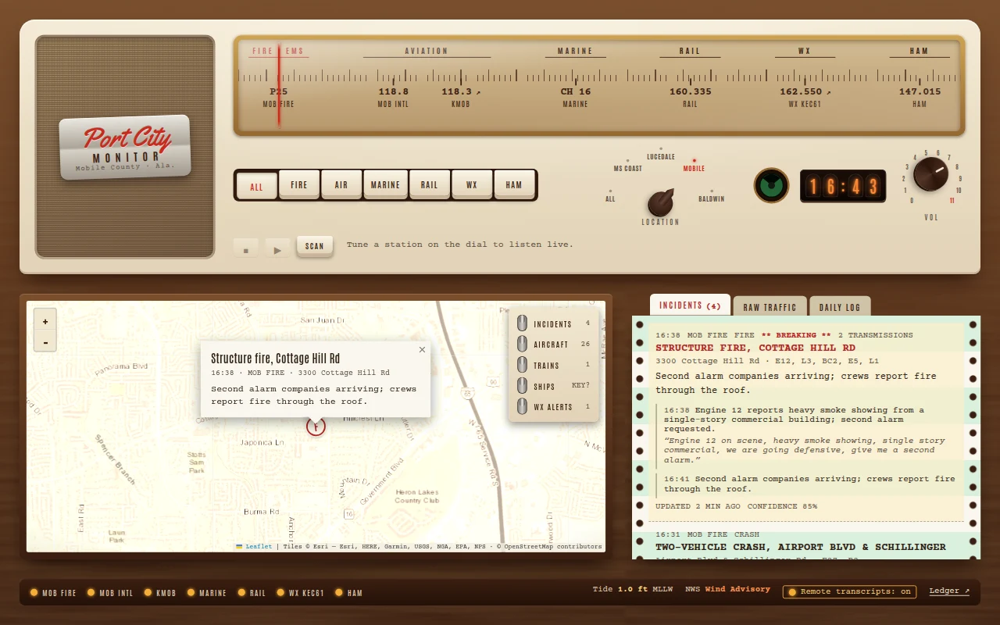
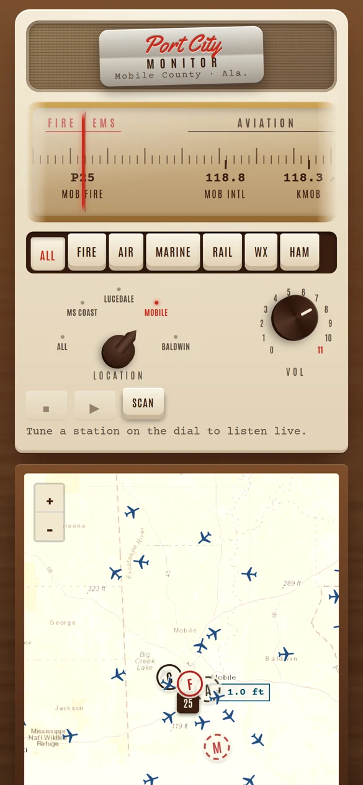

# Squelch

A scanner-radio receiver for your part of the world. Squelch listens to public scanner feeds, transcribes every transmission, triages them into incidents on a map, and prints a daily log of the stories worth hearing — dressed as a 1950s tabletop radio.

<p align="center">
  
  &nbsp;
  
</p>
<p align="center"><sub>Shown with the Gulf Coast example config and sample data.</sub></p>

- **Live map** of incidents (fires, crashes, rescues, police calls, hazards), each with its transcript and audio clip
- **Dial, band keys and a Location knob** to tune any feed live or **Scan** new traffic across the channels you pick — with a resume delay after each transmission, **Hold/Resume**, **◁ Prev** to step back to channels it stopped on, and per-channel **priority** and **lockout** (tap a station while scanning: PRI → L/O → normal)
- **Closed captions and channel stories**: captions follow the audio; the title line says what each channel's conversation is about, and tapping it opens that story's key facts (units, command, size-up, status…) and a chronology that updates as traffic arrives
- **Notifications**: Web Push when a story turns significant, tuned per browser (sensitivity and favourite channels); see **[docs/NOTIFICATIONS.md](docs/NOTIFICATIONS.md)**
- **Daily log**: after midnight, each area's day is read back and the best storylines are printed, with a highlight reel of the real audio
- **Live map layers**: aircraft (ADS-B), Amtrak trains, NWS weather alerts, tide gauges, ships (AIS)
- **Station Manual** (`/manual.html`, linked at the bottom of the receiver): how every part works in detail, plus the **Ledger**: every AI and API call with timing, tokens and cost
- **Studio** (owner only, in the Station Manual): suggests light stories ranked by humor and turns one into a short comic or cartoon over the real radio, as an MP4 and a web page, kept in a library with its models and cost

## Requirements

| | Why | Cost |
|---|---|---|
| Node.js 22.13+ | built-in SQLite | free |
| `ffmpeg` + `ffprobe` on PATH | stream capture and audio processing | free |
| [OpenRouter](https://openrouter.ai) API key | speech-to-text, triage, daily digest, speech gate | roughly **$1–2 a day** for ~10 busy feeds; the Ledger shows your actual spend |
| [Broadcastify Premium](https://www.broadcastify.com/premium/) | the stream server only admits Premium accounts (a free account gets `401`) | $15 / 6 months or $30 / year |

## Install

```
git clone https://github.com/iamneilroberts/squelch && cd squelch
npm install
cp .env.example .env
cp sources.example.json sources.json
npm start
```

Then open http://localhost:8077.

1. In `.env`, set `OPENROUTER_API_KEY`, `BROADCASTIFY_LOGIN` (your RadioReference/Broadcastify **username**, not your email) and `BROADCASTIFY_PASSWORD`.
2. In `sources.json`, describe your area and its feeds — see **[docs/ADD-YOUR-REGION.md](docs/ADD-YOUR-REGION.md)**.
3. Restart. Green lamps along the bottom mean a feed is being received.

To see a complete, real configuration, run the Gulf Coast example (Mobile & Baldwin AL, George/Greene and the MS Gulf Coast): `SOURCES_FILE=examples/gulf-coast.json npm start`.

No keys yet? `DB_PATH=data/demo.db SOURCES_FILE=examples/gulf-coast.json node scripts/seed-demo.mjs` then `DB_PATH=data/demo.db SOURCES_FILE=examples/gulf-coast.json INGEST=0 PORT=8078 npm start` renders sample incidents and a sample day.

## How it works

```
feed ─► ffmpeg 45 s segments ─► squelch ─► speech-to-text ─► Jev gate ─► triage ─► geocode ─► map / log
                                   │                             │
                     hum & dead air dropped here      routine chatter skips triage
                     (no transcription cost)          (every transmission is still recorded)
```

| Step | Where | Default |
|---|---|---|
| Silence + **adaptive squelch** | `src/ingest/stream.mjs`, `src/ingest/vad.mjs` | keeps only what rises above each clip's own background in 16 spectral bands; drops hum/static clips before they cost anything |
| Speech-to-text | `src/ai/transcribe.mjs` | `google/gemini-3.8-flash` via OpenRouter audio input |
| Speech + newsworthy gate | `src/ai/jev.mjs` | TypeSafe Jev: drops model filler, skips triage for routine traffic (5 % audited) |
| Incident triage | `src/ai/triage.mjs` | `openai/gpt-6-luna`, strict JSON; merges follow-ups into open incidents |
| Channel story | `src/ai/thread.mjs` | `openai/gpt-6-luna`: continues or starts each channel's story, keeps its facts and writes a chronology line per transmission |
| Geocoding | `src/ingest/geocode.mjs` | OpenStreetMap Nominatim, bounded to the feed's region |
| Daily digest + reel | `src/digest.mjs` | `openai/gpt-6-luna-pro` |

### How Scan works

Scan plays **recordings, not live streams**: each new clip from the channels the Location knob and band keys show, back to back, about a minute behind live. The page opens scanning; the first sound waits for a tap, because browsers won't play audio before you touch the page.

- **Order:** priority channels first, then oldest first. Scan starts with up to 3 clips from the last 2 minutes and keeps at most the newest 20 queued, so it never falls far behind.
- **After each transmission** it waits 2.5 s on that channel. A reply there, or any priority traffic, plays at once, and you have time to press **Hold**. **Hold/Resume** stays on one channel; **◁ Prev** steps back through the channels it stopped on and replays each.
- **While scanning, tap a station** to cycle it normal → **PRI** (jumps the queue and interrupts ordinary traffic) → **L/O** (locked out). Saved in the browser.
- **Noisy channels never stall it.** Scan can only play clips that passed every stage above. A channel carrying only hiss, hum or an open mic never produces one: the adaptive squelch drops it before transcription, the filters drop invented text, and the speech gate drops filler. Real but dull chatter still plays; lock it out.

The receiver's **Station Manual** (`/manual.html`) covers this and every other stage in detail.

Models are chosen by the bench (`npm run bench`, results in `bench/RESULTS.md`) and can be overridden with `TRANSCRIBE_MODEL`, `TRIAGE_MODEL`, `DIGEST_MODEL`. Claude models go direct through the Anthropic SDK when `ANTHROPIC_API_KEY` is set.

## Sharing it

Squelch is built to run at home. To let a few people see it, put it behind a Cloudflare Tunnel with Cloudflare Access — see **[docs/SHARING.md](docs/SHARING.md)**. Tunnel visitors don't see raw transcripts unless you switch that on, and they listen live with **their own** Broadcastify Premium login, never yours.

## Use it responsibly

- **Personal use.** Broadcastify's terms restrict re-streaming. Keep your instance private or invitation-only.
- **Encrypted traffic stays encrypted.** Many police talkgroups are encrypted; Squelch only uses audio that public feeds already carry. Don't attempt to decrypt anything.
- **Transcripts contain personal details** (names, addresses, plates). Triage keeps them out of incidents; raw transcripts are hidden from remote visitors by default.
- **AI makes mistakes.** Transcribers can invent plausible dispatches from static; the squelch and gate catch most of it, not all. This is a hobby monitor, not an emergency service — call 911.
- LiveATC and NOAA Weather Radio entries are listen-only links; their audio isn't recorded.

## Development

- `npm run bench -- all` — model bench (triage, transcription, digest) against `bench/fixtures/`
- `src/meter.mjs` — every AI/API call is a span; the Ledger reads them
- Settings worth knowing: `RECORD_DAYS` (audio retention, default 7), `JEV_GATE` (`active` / `shadow` / `off`), `ADAPTIVE_SQUELCH=0`, `INGEST=0` (map only)
- Studio (`src/studio/`): `STUDIO_DAILY_USD` (default 2, the day's cap on Studio spend), `STUDIO_HUMOR_MODEL` (default the triage model), `STUDIO_SCRIPT_MODEL` and `STUDIO_CARTOON_MODEL` (default `anthropic/claude-sonnet-5.5`), `STUDIO_IMAGE_MODEL` (default `google/gemini-2.5-flash-image`), `CHROME_PATH` (Chrome for cartoon checks and MP4s; needs the optional `puppeteer-core`). Files live in `data/animations/<id>/`; `node scripts/studio-import.mjs <dir> <meta.json>` adds one made elsewhere
- Speech-to-text input trials: `STT_INPUT` (`mp3` / `wav`: transcribe the stored MP3 or the lossless clip, default `mp3`), `STITCH=1` (a segment that ends mid-transmission waits for the next one and they become one clip; off by default), `STT_AB_RATE` (0–1, default 0: the share of clips also transcribed from the other input, kept in `stt_ab` and judged with `node --env-file-if-exists=.env scripts/stt-ab-judge.mjs`)

## License

MIT — see [LICENSE](LICENSE).
